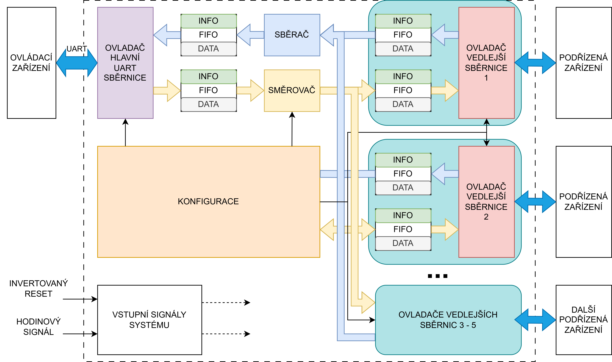
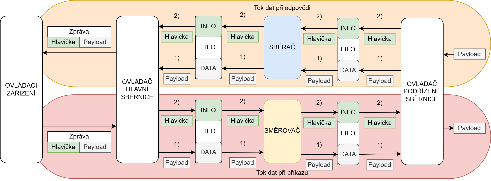

# Vnitřní protokol obvodu

Popis systému předávání dat z hlavní sběrnice vedlejším a generování zpráv z vedlejší zběrnice pro hlavní.

## Zpracování dat

## Následují tabulky popisující mapy registrů:

- **Registry celkového návrhu**  
- **Sběrnice UART**  
- **Sběrnice I2C**  
- **Sběrnice SPI**  
- **Mapa nastavení baudrate**

### Registry celkového návrhu

| Pozice | Jméno      | Velikost | Default | Popis                                      |
|--------|------------|----------|---------|---------------------------------------------|
| **1. Registr**      |          |          |         |                                             |
| 2:0    | clk_div    | 3b       | 0       | výběr baudrate viz tabulka „Možnosti baudrate“ |
| 5      | par_en     | 1b       | 0       | povolení bitu parity                       |
| 6      | par_odd    | 1b       | 0       | přepnutí na lichou paritu                  |
| **2. Registr**      |          |          |         |                                             |
| 4:0    | timeout    | 5b       | 0       | počet bajtů (+1) do timeoutu               |
| **3. Registr**      |          |          |         |                                             |
| 7:0    | enable     | 8b       | 0       | signály povolení sběrnic                   |
| **Chybový registr** |          |          |         |                                             |
| 0      | frame      | 1b       | 0       | chyba ukončení rámce                       |
| 1      | parity     | 1b       | 0       | chyba parity                               |
| 3      | data       | 1b       | 0       | chyba velikosti dat                        |
| 6      | odpojení   | 1b       | 0       | nedetekováno zařízení                      |
| 7      | šum        | 1b       | 0       | chyba šumové hladiny                       |

### Registry UART sběrnice

| Pozice | Jméno      | Velikost | Default | Popis                                      |
|--------|------------|----------|---------|---------------------------------------------|
| **1. Registr**      |          |          |         |                                             |
| 2:0    | clk_div    | 3b       | 0       | výběr baudrate viz tabulka „Možnosti baudrate“ |
| 4:3    | slovo      | 2b       | 0       | délka slova (+5) v bitech                   |
| 5      | par_en     | 1b       | 0       | povolení bitu parity                       |
| 6      | par_odd    | 1b       | 0       | přepnutí na lichou paritu                  |
| 7      | rst        | 1b       | 0       | reset sběrnice                             |
| **2. Registr**      |          |          |         |                                             |
| 4:0    | timeout    | 5b       | 0       | počet bajtů (+1) do timeoutu               |
| 5      | ready_en   | 1b       | 0       | povolení CTS-RTS                           |
| 6      | ready_dir  | 1b       | 0       | směr CTS-RTS (0 => RTS dovnitř)            |
| 7      | polarita   | 1b       | 0       | polarita sběrnice                          |
| **Chybový registr** |          |          |         |                                             |
| 0      | frame      | 1b       | 0       | chyba ukončení rámce                       |
| 1      | parity     | 1b       | 0       | chyba parity                               |
| 3      | data       | 1b       | 0       | chyba velikosti dat                        |
| 5      | timeout    | 1b       | 0       | timeout během přenosu                      |
| 7      | šum        | 1b       | 0       | chyba šumové hladiny                       |

### Registry I2C sběrnice

| Pozice | Jméno        | Velikost | Default | Popis                                      |
|--------|--------------|----------|---------|---------------------------------------------|
| **1. Registr**        |          |          |         |                                             |
| 2:0    | clk_div      | 3b       | 0       | výběr baudrate viz tabulka „Možnosti baudrate“ |
| 4      | inter_en     | 1b       | 0       | zapnutí přerušení                          |
| 5      | slv_en       | 1b       | 0       | slave mód (neimplementováno)               |
| 6      | multimaster  | 1b       | 0       | povolení multimaster                       |
| 7      | rst          | 1b       | 0       | reset sběrnice                             |
| **2. Registr**        |          |          |         |                                             |
| 6:0    | adresa       | 5b       | 0       | adresa pro slave mód                       |
| **Chybový registr**   |          |          |         |                                             |
| 0      | frame        | 1b       | 0       | chyba ukončení rámce                       |
| 1      | ack          | 1b       | 0       | chyba nepřišel ack                         |
| 2      | data_size    | 1b       | 0       | chyba velikosti dat                        |
| 3      | data_owf     | 1b       | 0       | chyba přeplnění dat                        |
| 4      | přerušení    | 1b       | 0       | detekováno přerušení                       |
| 5      | odpojení     | 1b       | 0       | odpojení od sběrnice                       |
| 6      | block        | 1b       | 0       | chyba zablokovaná sběrnice                 |
| 7      | šum          | 1b       | 0       | chyba šumové hladiny                       |

### Registry SPI sběrnice

| Pozice | Jméno      | Velikost | Default | Popis                                      |
|--------|------------|----------|---------|---------------------------------------------|
| **1. Registr**      |          |          |         |                                             |
| 2:0    | clk_div    | 3b       | 0       | výběr baudrate viz tabulka „Možnosti baudrate“ |
| 3      | data_dir   | 1b       | 0       | 0 => MSB první                             |
| 4      | SPOL       | 1b       | 0       | polarita CS (0 = 0 aktivní)                |
| 5      | CPOL       | 1b       | 0       | polarita hodin                             |
| 6      | CPHA       | 1b       | 0       | čtecí hrana (0 = první hrana)              |
| 7      | rst        | 1b       | 0       | reset sběrnice                             |
| **2. Registr**      |          |          |         |                                             |
| 2:0    | adresa     | 3b       | 0       | 3 => 8 CS logika                           |
| **Chybový registr** |          |          |         |                                             |
| 1      | block_reg  | 1b       | 0       | chyba nelze zapsat registr                 |
| 3      | data_owf   | 1b       | 0       | chyba přeplnění dat                        |
| 7      | šum        | 1b       | 0       | chyba šumové hladiny                       |

### Možnosti baudrate

| clk_div | UART        | I2C        | SPI      |
|---------|-------------|------------|----------|
| 0       | 9.6 Kbps    | 1.5 Kbps   | 20 Kbps  |
| 1       | 19.2 Kbps   | 2 Kbps     | 50 Kbps  |
| 2       | 28.8 Kbps   | 5 Kbps     | 100 Kbps |
| 3       | 57.6 Kbps   | 10 Kbps    | 200 Kbps |
| 4       | 76.8 Kbps   | 50 Kbps    | 400 Kbps |
| 5       | 115.2 Kbps  | 100 Kbps   | 1 Mbps   |
| 6       | 460.8 Kbps  | 200 Kbps   | 2 Mbps   |
| 7       | 921.6 Kbps  | 400 Kbps   | 4 Mbps   |

Každá sběrnice má svoje vlastní konfigurační a chybové registry. Tyto tabulky pouze popisují význam jednotlivých bitů pro každý typ sběrnice. Sběrnice tak mohou mít nezávisle na sobě jiná nastavení. Jedině nastavení celkového návrhu se týká a ovlivňuje všechny ostatní registry. Stav každé sběrnice se totiž při změně jejího *enable* signálu resetuje.

## Poznámky
 Některá nastavení nejsou podporována na všech sběrnicích, jako například povolení neočekávaných příchozích dat na I2C.
 
 Registr 3 (stavový registr) se resetuje po každém automatickém odeslání nebo při pokusu o zápis do registru 3.
 Reset bit resetuje ovladač sběrnice a ponechá hodnoty v konfiguračních registrech.

# Komunikační protokol je popsán [ZDE](comm_protocol.md).  
